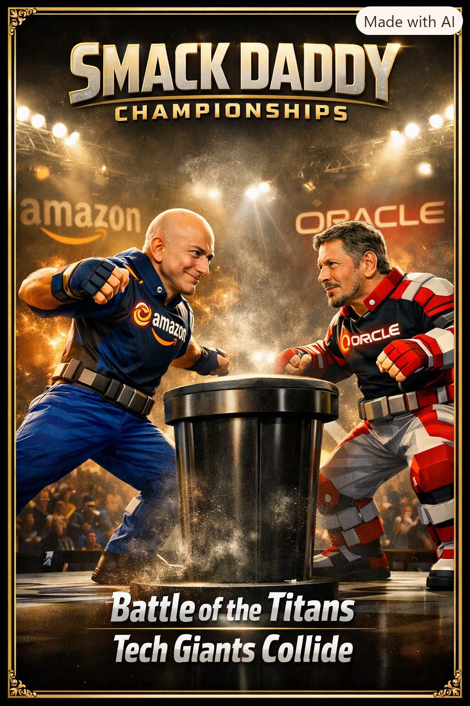

# 🏆 Smack Daddy Championships: Tech Titan Edition

<div align="center">
  
  <br />
  <br />

  [](https://www.typescriptlang.org/)
  [](https://threejs.org/)
  [](https://react.dev/)
  [](https://tailwindcss.com/)
  [](https://vitejs.dev/)
  [](./LICENSE)
</div>

> **"Battle of the Titans — Tech Giants Collide."**  
> A studio-grade 3D cinematic slap-fighting game where ten global tech leaders step up to a fluted black metallic slap barrel inside their corporate HQ stadium arenas. Engineered with 100% volumetric 3D fighter rigs (`Contender3DRig`), sculpted 3D facial anatomy, detachable 3D eyeglasses, embossed 3D chest armor branding, deterministic Power Slap biomechanics, a 4-tier Knockout & 10-Count Recovery system, a 10-chapter Single-Player Story Campaign, and an autonomous Agent-to-Agent (A2A) Behavior Tree simulation mode.

---

## ✨ Key Architectural Highlights

### 🗿 1. 100% Volumetric 3D Contender Rigs (`Contender3DRig`)
Zero 2D cards, zero flat planes, and zero sideways UV sphere distortion. Every contender is constructed from hierarchical 3D geometry primitives in `src/engine/ArenaScene3D.ts`:
- **Sculpted 3D Head & Facial Anatomy (`FacialFeaturesRig`)**:
  - Volumetric upper cranium dome, sculpted 3D cheekbones, prominent 3D brow ridge, and articulated 3D eyebrows.
  - 3D eyeballs with colored irises and pupils, 3D nose bridge and tip, and sculpted 3D outer ears.
  - **Hinged 3D Lower Jaw & Chin**: Drops open and shifts laterally on heavy slap contact, revealing an interior mouth cavity and teeth strip.
  - **Custom 3D Hair, Beards & Detachable Eyeglasses**: Individual 3D hair locks/curls/crests, 3D goatees/beards, and 3D eyeglasses (Jensen Huang, Bill Gates, Sundar Pichai, Satya Nadella) that physically fly off into the arena with gravity and spin on critical slaps ($\ge 130\text{ N}$).
- **Poster-Accurate 3D Exosuit Armor**:
  - Broad V-tapered chest and pectoral plates featuring both a **3D geometric company emblem** and an **embossed 3D chest wordmark badge** (`amazon` with orange smile arrow, `ORACLE`, `SPACEX`, `NVIDIA`, `OpenAI`, `Meta`, `CLAUDE`, `Google`, `Microsoft`, `WIN 95`).
  - **Segmented Tactical Utility Belt**: 8 radial metallic belt cartridges around the waist with a glowing championship buckle.
  - **Connected Deltoid Pauldrons, Articulated 5-Finger Slap Gauntlets & Shin Straps**: Ball-jointed shoulders with glowing pauldron ribs, chalked open-palm slap hands with 3-segment fingers and thumbs, knee pads, twin metallic shin straps, and armored combat boots.

---

### 🏟️ 2. Championship Stadium Arena & Fluted Slap Barrel
- **Central Fluted Metallic Slap Barrel**: Beveled dark-titanium championship barrel with top rim padding and a recessed **magnesium chalk basin** with a glowing white talcum mound.
- **Dual Contender Stadium Signage Trusses**: High-contrast illuminated company signage boards suspended in the upper stadium rafters behind the Left Corner and Right Corner contenders (e.g., `AMAZON` vs `ORACLE`), paired with overhead golden stadium floodlight trusses and volumetric light cones.
- **Interactive 3D Camera Orbit + 4 Broadcast Presets**:
  - Drag anywhere on the 3D viewport to orbit and inspect the volumetric 3D rigs from any angle (smoothly damps back on release).
  - Switch between **Broadcast Wide**, **Over-Shoulder P1**, **Over-Shoulder P2**, and **Barrel Close-Up** (`C` key), plus automatic slow-motion 360° KO orbit replays.

---

### 🧮 3. Deterministic Slap Physics Engine (`src/engine/slapPhysics.ts`)
Every slap is governed by deterministic biomechanical formulas:

$$\text{SlapForce} = (\text{ArmSpeed} \times \text{Mass} \times \text{Torque}) \times \text{PrecisionMultiplier}$$

$$\text{Damage} = \text{SlapForce} \times (\text{ChinWeakness} \times \text{AngleModifier})$$

$$\text{Knockout Condition: } \text{Damage} \ge \text{Effective KOResistance}$$

| Strike Vector | Angle Modifier | Biomechanical Profile |
| :--- | :---: | :--- |
| **Mid Cheek** (`MID_CHEEK`) | `1.02×` | Balanced open-palm cheek compression with maximum sweet-spot consistency |
| **Jawline Lever** (`JAWLINE_LEVER`) | `1.25×` | Maximum mandibular rotational torque; primary trigger for `CLEAN_KO` & `CRITICAL_KO` |
| **High Temple** (`HIGH_TEMPLE`) | `1.19×` | Vestibular equilibrium disruption; primary trigger for multi-axis `STAGGER_KO` |

---

### 💥 4. 4-Tier Knockout (KO) & 10-Count Recovery System
When `Damage ≥ Effective KOResistance`, the engine evaluates overkill ratio, strike vector, and fatigue to trigger one of four KO classifications:

| KO Classification | Trigger Rule | Visual & Physics Impact | 10-Count Recovery Mini-Game |
| :--- | :--- | :--- | :--- |
| **Clean KO** (`CLEAN_KO`) | `Damage ≥ 1.15 × KOResistance` | Instant rigid-body backward collapse, spotlight flash, 300-particle chalk burst | `16%` recovery zone (`4.4 rad/s` needle) → `38% HP` + **Isometric Reboot** (`+15%` Chin Brace) |
| **Staggered KO** (`STAGGER_KO`) | `High Temple` vector or `Fatigue ≥ 35%` | Multi-axis vestibular wobble across barrel before lateral knee buckle | `22%` recovery zone (`4.9 rad/s` needle) → `44% HP` + **Gyro Stabilizer** |
| **Delayed KO** (`DELAYED_KO`) | `Damage ∈ [1.00×, 1.15×) KOResistance` | Defender freezes gripping barrel rim for `0.65s`, then crumples forward | `28%` recovery zone (`3.5 rad/s` needle) → `50% HP` + **Second-Wind Surge** (Special ready) |
| **Critical KO** (`CRITICAL_KO`) | `Damage ≥ 1.28 × KOResistance` or `≥90%` Sweet-Spot Jawline | `0.20×` super slow-motion, flying 3D glasses, dual shockwave rings, 360° camera orbit | `12%` recovery zone (`5.5 rad/s` needle) → `35% HP` + **Titan Overclock** (`+30%` SlapForce) |

---

### 🏛️ 5. The 10 Tech Titan Contenders & Corporate HQ Arenas (`src/data/fighters.ts`)

| Ch. | Contender | Company | 3D Corporate HQ Arena | Signature Exosuit & Special Ability |
| :-: | :--- | :--- | :--- | :--- |
| **1** | **Jeff Bezos** | Amazon | Seattle Geodesic Spheres (Biophilic Domes & Fulfillment Rings) | Prime Logistics Exosuit · *Prime Delivery* (`+25%` Sweet-Spot Window) |
| **2** | **Sam Altman** | OpenAI | San Francisco AI Lab (Rotating Violet Alignment Monoliths) | Frontier Alignment Suit · *Predictive Strike* (`+22%` Angle Multiplier) |
| **3** | **Elon Musk** | SpaceX | Hawthorne Rocket Hangar (Stainless Starship Booster & Raptor Plume) | Starship Raptor Exosuit · *Falcon Boost* (`+28%` Rotational Torque) |
| **4** | **Jensen Huang** | NVIDIA | Santa Clara GPU Cathedral (Neon-Green Tensor Core Spires) | Blackwell Leather Armor · *GPU Overclock* (`+24%` Arm Speed & Force) |
| **5** | **Mark Zuckerberg** | Meta | Menlo Park Metaverse Chamber (Wireframe Horizon & Portal Arch) | Horizon Haptic Mesh Suit · *Metaverse Phase-Shift* (`-25%` Incoming Damage) |
| **6** | **Larry Ellison** | Oracle | Austin Data Tower Arena (Crimson SQL Server Monoliths & Lasers) | Autonomous Red Samurai Plate · *Red Armor Pulse* (`+30%` Chin Durability) |
| **7** | **Dario Amodei** | Anthropic | SF Constitutional Safety Lab (Warm Gold-White Harmonic Core) | Claude Constitutional Aegis · *Safety Protocol* (`28%` Force Absorption) |
| **8** | **Sundar Pichai** | Google | Mountain View Rainbow Campus (4-Color Quantum Arches) | DeepMind Quantum Suit · *Rainbow Algorithm* (`+20%` Precision & Trauma) |
| **9** | **Satya Nadella** | Microsoft | Redmond Cloud Arena (Hyperscale Azure Server Citadel) | Azure Hyperscale Plate · *Cloud Surge* (`1.25×` SlapForce Multiplier) |
| **10** | **Bill Gates** | Classic MS | Retro Windows Grid Chamber (1995 Cyan Vector Horizon & 4-Pane Core) | Windows 95 Executive Grid Armor · *Retro Debug* (`-20%` Opponent Precision) |

---

## 🎮 Controls & Keyboard Shortcuts

| Input / Shortcut | Action |
| :--- | :--- |
| **Pointer Drag on 3D Arena** | Orbit 3D camera around the contenders and slap barrel |
| **`Space` / Center Action Button** | Lock **Slap Force Precision Meter** (Offense) / Lock **Chin Brace Meter** (Defense) / Lock **10-Count Recovery Needle** |
| **`1` / `2` / `3` Buttons** | Select Wind-Up Cadence (`On 1`, `On 2`, or `On 3` for maximum rotational torque) |
| **`T` Key / Taunt Button** | Trigger contender voice synthesis trash-talk & chalk puff |
| **`F` Key / Fakeout Button** | Execute psychological flinch-bait shoulder pop (`+15%` next slap torque if defender flinches) |
| **`C` Key / Cam Button** | Cycle between 4 broadcast camera angles (`Broadcast Wide`, `Over-Shoulder P1`, `Over-Shoulder P2`, `Barrel Close-Up`) |
| **`H` Key / Hide Controls Toggle** | Toggle **Cinema / Zen Mode** (collapses bottom control dock for an unobstructed 3D stadium view) |

---

## 🗂️ Repository Structure

```text
smack-daddy-championships-tech-titan-edition/
├── .github/
│   ├── ISSUE_TEMPLATE/
│   │   ├── bug_report.md            # Structured bug report template
│   │   └── feature_request.md       # Contender / arena / physics feature template
│   ├── workflows/
│   │   └── ci.yml                   # GitHub Actions CI (Node 22, Typecheck & Vite Build)
│   ├── dependabot.yml               # Automated dependency security updates
│   └── PULL_REQUEST_TEMPLATE.md     # Pull request verification checklist
├── docs/
│   └── ENGINE_SPEC.md               # Deep-dive 3D Volumetric Rig, Biomechanics & Audio Architecture
├── public/
│   ├── assets/aistudio/             # Championship Poster & 10 Contender Portrait Assets
│   └── robots.txt                   # Search engine crawler configuration
├── src/
│   ├── components/
│   │   ├── FighterCodexModal.tsx    # Interactive 10-Contender Roster, P1/P2 Matchup Selector & Upgrades
│   │   └── PhysicsSpecModal.tsx     # 10 Arenas Challenge Selector, KO Rules & Live Physics Simulator
│   ├── data/
│   │   └── fighters.ts              # 10 Contender Profiles, KO Classifications & 11 Story Armor Upgrades
│   ├── engine/
│   │   ├── ArenaScene3D.ts          # Three.js WebGL2 Engine: Volumetric 3D Rigs, Stadium Signage & FX
│   │   ├── slapPhysics.ts           # Deterministic Slap Physics & A2A Behavior Tree Intelligence
│   │   └── soundEffects.ts          # Procedural Web Audio API Sound Engine & SpeechSynthesis Trash-Talk
│   ├── App.tsx                      # Broadcast Scoreboard, Cinema Mode Dock & Turn-Based State Machine
│   ├── index.css                    # Tailwind CSS v4 & Championship Display Typography
│   └── main.tsx                     # React 19 Entry Point
├── CHANGELOG.md                     # Version history & release notes
├── CODE_OF_CONDUCT.md               # Contributor Covenant Code of Conduct
├── CONTRIBUTING.md                  # Developer setup & contender authoring guide
├── LICENSE                          # Apache 2.0 License
├── SECURITY.md                      # Security policy & vulnerability reporting
├── index.html                       # SEO, OpenGraph, Twitter Card & Schema.org JSON-LD Entry HTML
├── metadata.json                    # Application capability metadata
├── package.json                     # Scripts & dependencies
├── tsconfig.json                    # Strict TypeScript configuration
└── vite.config.ts                   # Vite 8 bundler configuration
```

---

## 🚀 Quick Start & Local Development

### Prerequisites
- **Node.js** `>= 20.0.0` (Node `22 LTS` recommended)
- **npm** or **bun**

### 1. Clone & Install
```bash
git clone https://github.com/YOUR_USERNAME/smack-daddy-championships.git
cd smack-daddy-championships
npm install
```

### 2. Start the Development Server
```bash
npm run dev
```
Open `http://localhost:3000` in your browser.

### 3. Typecheck & Build for Production
```bash
npm run lint
npm run build
npm run preview
```

---

## 🌐 Syncing & Pushing to GitHub

If you are syncing directly from AI Studio or pushing from your local terminal:

```bash
git init
git add .
git commit -m "feat: release Smack Daddy Championships v2.0 (3D Volumetric Rigs & Stadium Overhaul)"
git branch -M main
git remote add origin https://github.com/YOUR_USERNAME/smack-daddy-championships.git
git push -u origin main
```

---

## 📄 License

Distributed under the **Apache License 2.0**. See [`LICENSE`](./LICENSE) for full details.
