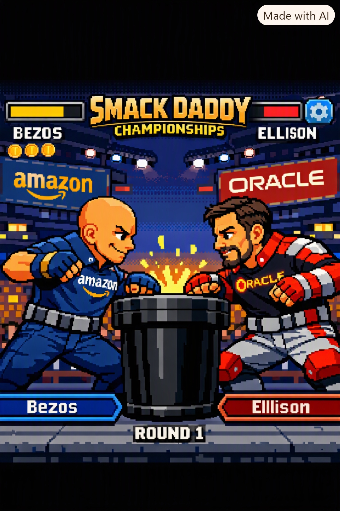

# 🏆 Smack Daddy Championships: Pixel Edition

<div align="center">
  
  <br />
  <br />

  [](https://www.typescriptlang.org/)
  [](https://developer.mozilla.org/en-US/docs/Web/API/Canvas_API)
  [](https://react.dev/)
  [](https://tailwindcss.com/)
  [](./public/smack-daddy-pixel-edition.html)
  [](./LICENSE)
</div>

> **"Battle of the Titans — 16-Bit Arcade Tech Giants Collide."**  
> A high-performance 60 FPS 2D 16-bit pixel-art arcade slap-fighting game where ten global tech leaders step up to a fluted dark-iron slap podium inside a packed championship stadium. Engineered with a coordinate-addressed 16-bit procedural pixel sprite matrix (`drawFighter`), dynamic corporate jumbotrons (`amazon` vs `ORACLE`), deterministic Power Slap biomechanics, a 4-tier Knockout & 10-Count Recovery system, an autonomous Agent-to-Agent (`A2A Auto`) simulation loop, Web Audio API sound synthesis, and a **100% self-contained single-file HTML5 build** (`/public/smack-daddy-pixel-edition.html`) ready for Capacitor / Android / Amazon Appstore packaging.

---

## ✨ Key Architectural Highlights

### 🎨 1. Coordinate-Based 16-Bit Pixel-Art Sprite Matrix (`drawFighter`)
Every contender is procedurally rendered via a coordinate-addressed 16-bit pixel-block matrix (`drawFighter(ctx, characterId, state, x, y, facingRight)`) in `src/engine/ArenaScene3D.ts` and `public/smack-daddy-pixel-edition.html`:
- **Head & Cranium Sub-Blocks**: Sculpted 16-bit skull contour, cheekbone shading, ear with inner tragus pixel, forehead specular highlights, and dynamic lower jaw/chin configuration.
- **Character-Specific Hair & Facial Hair**:
  - **Jeff Bezos**: Polished bald dome with multi-pixel specular light reflections, confident smirk, deep blue Amazon polo with yellow arrow branding across the chest.
  - **Larry Ellison**: Dark combed-back hair with distinct silver temples, stern squinted eyes, trimmed goatee, and red Oracle executive racing jacket with white stripes.
  - **Mark Zuckerberg**: Short rigid crew cut, blank deadpan stare with periodic robotic wink frame, and dark grey Meta tee.
  - **Elon Musk**: Tousled brown hair, sarcastic grin, and futuristic black collar-up jacket with cyan rocket-streak trim.
  - **Jensen Huang**: Flowing dark/silver-streaked locks, thin glasses pixels, and pitch-black biker leather jacket with silver zipper lines and collar flaps.
  - **Sam Altman**: Neat brown parted hair, mild intellectual expression, and minimalist gray zip-up tech hoodie.
  - **Satya Nadella**: Professional styled dark hair, warm approachable smile, thin glasses pixels, and sharp navy-blue enterprise blazer.
  - **Tim Cook**: Distinguished silver hair, thin-framed glasses pixels, immaculate posture, and dark titanium-blue polo.
  - **Sundar Pichai**: Composed academic expression, neat dark hair, glasses pixels, and smart-casual multi-accented Google executive layer.
  - **Dario Amodei**: Focused researcher expression, curly dark hair, glasses pixels, and structured charcoal vest over a dark collar.
- **Dynamic Animation States & Impact Juice**:
  - **Idle Breathing (`IDLE`)**: Torso and shoulders shift vertically by `1px` every 30 frames (`Math.floor(frameCount / 30) % 2`).
  - **Slap Wind-Back (`WIND_UP`)**: Forearm and open chalked palm cock back `5px` while the body compresses vertically (squash & stretch).
  - **Impact Frame (`STRIKE` / `HIT_RECOIL`)**: Flashes the struck character pure white for `2` frames, spawns yellow/orange pixel hit-sparks and white magnesium chalk clouds on the central podium, renders bruised cheek pixels and flying sweat droplets, and shakes the screen coordinates.

---

### 🕹️ 2. Persistent Arcade Navigation & HUD Layout
- **Top Control Bar**: `[ROSTER]` `[SFX TOGGLE]` `[A2A AUTO TOGGLE]` `[CODEX]` `[DOWNLOAD 1-FILE HTML]`.
- **Dual Top Health Bars**: Dynamic Chin Durability bars (Yellow P1 bar on left with interactive Gold Token counters `x03`; Red P2 bar on right with round pips and active signature indicator).
- **Center Stadium Stage**: Overhead floodlight trusses, left and right corporate LED jumbotrons (`amazon` blue vs `ORACLE` red), 76 animated 16-bit spectators, and the central dark-iron slap podium.
- **Bottom Action Hub**: Active fighter nameplates, an oscillating sweet-spot timing bar (`"TAP WHEN THE NEEDLE HITS THE SWEET SPOT"`), and massive touch-friendly `[SLAP!]` and `[BRACE!]` buttons.

---

### 🏛️ 3. The 10-Contender Roster & Signature Mechanics (`src/data/fighters.ts`)

| # | Contender | Nickname | Company | Signature Ability & Mechanic |
| :-: | :--- | :--- | :--- | :--- |
| **1** | **Jeff Bezos** | *"The Prime Apex"* | Amazon | **Same-Day Delivery** — Triple-slap combo burst & `+25%` sweet-spot precision window |
| **2** | **Sam Altman** | *"The Alignment Oracle"* | OpenAI | **Singularity Shield** — Reflects kinetic energy & `+22%` jawline angle multiplier |
| **3** | **Elon Musk** | *"The Meme Engine"* | xAI / SpaceX | **RNG Rocket** — High-variance critical orbital torque (`+28%`) or self-stumble |
| **4** | **Jensen Huang** | *"The Leather Jacket Maestro"* | NVIDIA | **Ray-Traced Overdrive** — Screen-blinding neon-green particle burst & `+24%` slap force |
| **5** | **Mark Zuckerberg** | *"The Metaverse Monarch"* | Meta | **VR Glitch** — Teleport counter-strike & `-25%` incoming head-whip recoil |
| **6** | **Larry Ellison** | *"The Database Overlord"* | Oracle | **Cloud Lock** — Interferes with opponent timing window & `+30%` chin durability |
| **7** | **Dario Amodei** | *"The Anthropic Sentinel"* | Anthropic | **Constitutional Guardrail** — Absorbs `28%` of heavy strike impact & prevents critical KOs |
| **8** | **Sundar Pichai** | *"The Search Engine Sage"* | Google | **Infinite Scroll** — Loops opponent timing bars & `+20%` mandibular precision |
| **9** | **Satya Nadella** | *"The Cloud Optimizer"* | Microsoft | **Enterprise Synergy** — Stamina/health regeneration buffer & `1.25×` SlapForce multiplier |
| **10** | **Tim Cook** | *"The Wall Garden Samurai"* | Apple | **Privacy Wall** — Defensive counter specialist that bounces back incoming kinetic damage |

---

### 🔊 4. Procedural Web Audio API Sound Suite (`src/engine/soundEffects.ts`)
Zero external audio files required. All arcade sound effects are synthesized in real time using `AudioContext` oscillators and noise buffers:
- **Slap Impact**: Bandpass white-noise skin crack layered with a low-frequency sub-bass kinetic thud (`150Hz → 28Hz`).
- **Critical Hit Chime**: High-pitched 16-bit square-wave arpeggio (`523Hz → 1046Hz`).
- **Round Bell**: Metallic FM/additive championship ring bell at round start and knockout resolution.
- **Crowd Roar**: Filtered stadium noise swell that scales with slap force and knockouts.

---

## 📦 Packaging for Android, Fire OS & Amazon Appstore

This repository includes both the full modular Vite + React + TypeScript application **and** the 100% self-contained single-file build at [`public/smack-daddy-pixel-edition.html`](./public/smack-daddy-pixel-edition.html):

1. **Web / Capacitor Build**:
   ```bash
   npm install
   npm run build
   ```
2. **Single-File Standalone HTML**:
   Click **`[DOWNLOAD 1-FILE HTML]`** in the top navigation bar (or copy `public/smack-daddy-pixel-edition.html`) to run the entire game offline in any mobile WebView, Android APK wrapper, or Amazon Fire tablet at a locked 60 FPS.

---

## 🚀 Quick Start & Local Development

### Prerequisites
- **Node.js** `>= 20.0.0` (Node `22 LTS` recommended)
- **npm**

### 1. Clone & Install
```bash
git clone https://github.com/YOUR_USERNAME/smack-daddy-championships.git
cd smack-daddy-championships
npm install
```

### 2. Start the Development Server
```bash
npm run dev
```
Open `http://localhost:3000` in your browser.

### 3. Typecheck & Build for Production
```bash
npm run lint
npm run build
npm run preview
```

---

## 📄 License

Distributed under the **Apache License 2.0**. See [`LICENSE`](./LICENSE) for full details.
